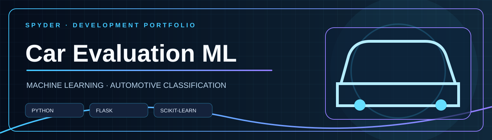

# Car Evaluation ML

A Python and Flask demonstration of car suitability classification from six categorical features: purchase price, maintenance, doors, capacity, luggage space and safety.

## Included implementation

- `train_model.py` downloads the UCI Car Evaluation dataset, one-hot encodes features, trains a random forest and prints holdout accuracy.
- `app.py` loads a saved classifier and encoder, serves a form, and renders a predicted category.
- `templates/` contains the frontend pages; `car_evaluation_model.pkl` and `encoder.pkl` are existing serialized artifacts.

## Local setup

```bash
python -m pip install -r requirements.txt
python app.py
```

Then open `http://127.0.0.1:5000`.

To retrain, run `python train_model.py` with access to the referenced UCI dataset.

## Known limitations

- Only load trusted `.pkl` files. The version used to create the saved model has not been confirmed.
- The existing serialized artifacts and Flask UI have not been integration-tested in this review.
- No validated benchmark metrics are claimed here. Re-run training and document the actual data split and performance before publishing results.
- This is a demonstration, not professional automotive purchasing advice.

## Maintainer

Abhinav Saini · GitHub: spyderabhi

## License and data

Refer to `LICENSE` and the UCI Machine Learning Repository's Car Evaluation dataset terms.
